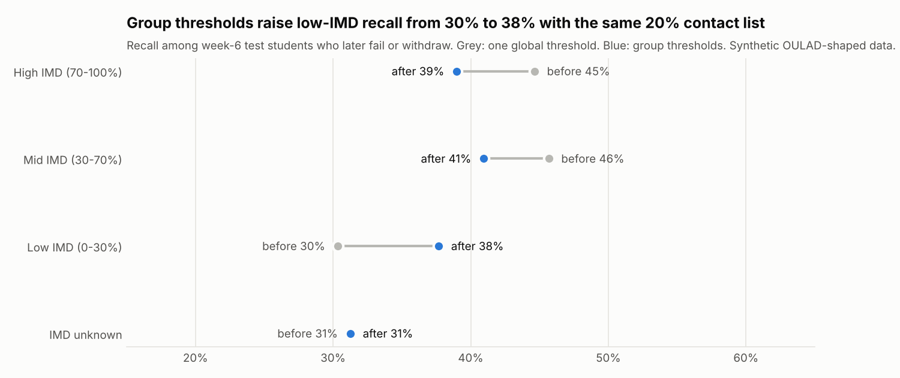
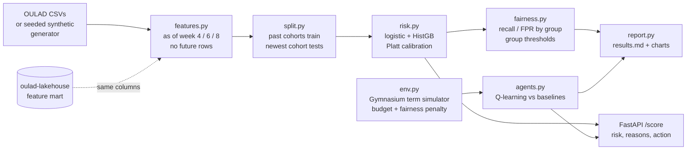
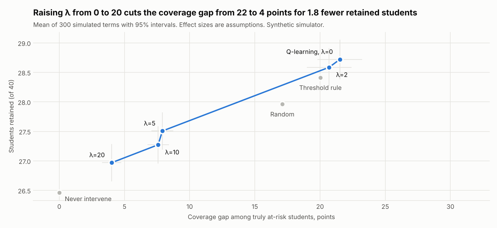

# Fair early intervention: who to contact, and how, when tutor time is limited


An early-warning system for online courses in two parts. First, a calibrated risk model predicts
in week 4, 6 or 8 which students will fail or withdraw, is measured the way a school would use
it (how many struggling students does a list of the top 20% reach?), and is audited for
fairness across gender, age, deprivation (IMD) and disability. Second, a reinforcement learning
policy decides who gets a cheap email and who gets an expensive tutor call within a fixed
budget, with a weight λ that trades retention against equal coverage between groups. A FastAPI
service returns the risk, the reasons and the recommended action for one student.

Based on my bachelor's thesis, Turku University of Applied Sciences, 2026. This repo is a clean,
tested re-implementation of the idea; all numbers below come from this code on **synthetic**
OULAD-shaped data, not from the thesis.

**What this project shows**

- Leakage-safe features "as of week N", proven by a test that rewrites the future and checks
  that no feature moves.
- Temporal validation: train on 2013 cohorts, test on the newest cohort, retakers removed from
  earlier splits.
- Metrics that match the decision: PR-AUC, recall at a fixed contact capacity, calibration error.
- A fairness audit that finds a planted problem (low-IMD recall 15 points lower) and a
  mitigation that cuts the gap to 3 points at the same list size, with the cost stated.
- A Gymnasium simulator, tabular Q-learning against three baselines, paired confidence
  intervals, and a λ trade-off curve. The simulator's assumptions are written down.
- A typed FastAPI service, 39 tests, mypy, ruff and CI.



## Problem

A university can only call a fraction of its students each term. If it calls the wrong ones,
students who could have been helped drop out. Two questions follow:

1. **Who is at risk, early enough to act?** And does the list find struggling students equally
   well in every group? A model that never sees a student's postcode can still miss the
   students from the poorest areas more often.
2. **What should we do for each flagged student, with this budget?** An email costs little and
   helps a little; a tutor call costs more and helps more; contacting the same student twice
   helps less the second time.

## Architecture



Step-by-step explanation of the code: **[docs/how-it-works.md](docs/how-it-works.md)**.
Why each choice was made: **[docs/decisions.md](docs/decisions.md)**.
What the model is for and not for: **[docs/model_card.md](docs/model_card.md)**.

The companion repo `oulad-lakehouse` builds a weekly feature mart from OULAD.
`features.load_feature_mart` reads its CSV export and checks it against this repo's column
contract (`KEY + FEATURES + PROTECTED + at_risk + week`).

## Quick start

```bash
python -m venv .venv && source .venv/bin/activate
make install          # pip install -e ".[dev]"
make check            # lint, types, tests (as in CI)
make train            # risk models + Q-learning policy into artifacts/
make serve            # API on :8000, docs on :8000/docs
make report           # re-run every experiment (about 3 minutes)
```

```bash
curl -X POST localhost:8000/score -H 'content-type: application/json' -d '{
  "week": 6, "imd_band": "10-20%", "budget_left": 30,
  "features": {"clicks_total": 40, "clicks_last_week": 0, "clicks_trend": -2.0,
    "active_days": 4, "distinct_sites": 3, "days_since_last_click": 12,
    "clicks_before_start": 0, "n_submitted": 0, "n_missed": 2, "n_late": 0,
    "mean_score": null, "num_of_prev_attempts": 1, "studied_credits": 120}}'
```

The response has `risk` (calibrated probability), `on_contact_list`, `risk_bucket`,
`top_reasons` (features that add the most log-odds) and `recommended_action`
(`none` / `email` / `call`) with the `policy` that chose it.

Real data: download OULAD from [analyse.kmi.open.ac.uk/open_dataset](https://analyse.kmi.open.ac.uk/open_dataset),
unzip into `data/raw/`, then run `fair-intervention report --source oulad --data-dir data/raw`.
The results file and both charts are regenerated.

## Results

All numbers are from `fair-intervention report` on **synthetic data**; the full tables are in
[docs/results.md](docs/results.md). The fairness problem was planted on purpose (see below), so
these numbers show that the pipeline finds and handles it, not how well it works on real
students.

**Risk model, week 6, newest cohort (1,937 students, 39.4% at risk), contact capacity 20%**

| Model | PR-AUC | Recall@20% | Precision@20% | ECE after calibration |
| --- | --- | --- | --- | --- |
| Logistic regression (served) | **0.702** | **38.8%** | **76.3%** | 0.025 |
| Hist. gradient boosting | 0.693 | 37.4% | 73.5% | 0.022 |

With 39% of students at risk, a 20% list can reach at most 50.9% of them.

**Fairness and mitigation (week 6, same 20% list size)**

| | One global threshold | Group thresholds (IMD) |
| --- | --- | --- |
| Recall, low IMD (0-30%) | 30.3% | 37.7% |
| Recall, mid IMD | 45.7% | 40.9% |
| Recall, high IMD | 44.6% | 39.0% |
| Equal-opportunity gap | 15.3 points | 3.3 points |
| Overall precision | 76.3% | 76.3% |

The cost is real but lands elsewhere than expected: overall precision did not fall, because the
model under-ranks low-IMD students who really are at higher risk. Instead, about 5 points of
recall move from the mid- and high-IMD groups to the low-IMD group, and low-IMD FPR rises from
5.7% to 9.6%. Gender and age gaps stay within noise (2-3 points); no effect was planted there.

**Intervention policies (simulator, 300 terms of 40 students, budget 40)**

| Policy | Students retained | Budget spent | Coverage gap |
| --- | --- | --- | --- |
| Never intervene | 26.46 ± 0.34 | 0 | 0 |
| Random | 27.96 ± 0.32 | 40.0 | 17.1 points |
| Threshold rule (call top bucket) | 28.41 ± 0.32 | 29.6 | 20.0 points |
| **Q-learning, λ = 0** | **28.72 ± 0.34** | 40.0 | 21.5 points |
| Q-learning, λ = 20 | 26.97 ± 0.32 | 40.0 | 4.0 points |

On the same seeded terms, Q-learning beats random spending by 0.76 ± 0.14 on the objective, but
its edge over the threshold rule (0.10 ± 0.16) is not significant.



The simulator's effect sizes (an email cuts dropout hazard by 20%, a call by 60%, half as much
on each repeat) are **assumptions**, not measurements. They let us compare policies under stated
assumptions. Before trusting any policy with real students, it should be checked with
off-policy evaluation on logged interventions (who was actually contacted, and what happened),
which OULAD does not contain.

## Design decisions (summary)

- **Week-N cut-off:** every feature uses only rows before day `7 * N`; students who already left
  are not scored.
- **Temporal split, grouped by student:** past cohorts train, the newest cohort tests.
- **Recall at capacity:** the metric matches the decision (a fixed number of calls).
- **Logistic regression is served:** within 1 point of PR-AUC of boosting here, and its reasons
  are exact.
- **Fairness through unawareness is not enough:** the model never sees IMD and is still unfair;
  measuring by group is required.
- **Group thresholds at a fixed list size:** before/after compare like with like; using a
  group label at decision time is a policy choice for the institution.
- **Tabular Q-learning with potential-based shaping:** without shaping the agent could not see
  the long-term effect of a call; the shaped rewards still add up to the true objective.
- **Paired evaluation on common random numbers:** honest intervals for "A beats B".

Full reasoning, costs and alternatives: [docs/decisions.md](docs/decisions.md).

## Project layout

```
src/fair_intervention/
  data/synthetic.py  seeded OULAD-shaped generator with the planted problem
  data/oulad.py      real CSV loader and schema check
  features.py        weekly features as of week N, feature-mart reader
  split.py           temporal split by presentation, grouped by student
  metrics.py         PR-AUC, recall@capacity, calibration error
  risk.py            logistic / HistGB models, Platt calibration, reasons, model bundle
  fairness.py        group metrics, equal-opportunity gap, group thresholds
  env.py             Gymnasium term simulator
  agents.py          Q-learning and baselines
  policy_eval.py     seeded evaluation, paired intervals, λ sweep
  deep.py            optional DQN / PPO (needs the [deep] extra)
  serve.py           FastAPI /score
  report.py          results.md and charts
  cli.py             fair-intervention generate | train | report | serve | deep
docs/                how-it-works, decisions, model card, results, charts
tests/               39 tests (1 skipped without the [deep] extra), 98% coverage
```

## Testing and quality

- **39 tests**: no leakage (future rows rewritten, labels flipped), feature counts on a
  hand-built student, temporal split order and retaker removal, recall@capacity, ECE and group
  metrics on hand-computed examples, group thresholds equalise recall, the mitigation shrinks
  the gap on synthetic data, the Gymnasium env checker, determinism with a seed, budget never
  negative, diminishing effect of repeat calls, shaped rewards sum to the objective, Q-learning
  beats random with a paired interval above zero, the λ weight shrinks the gap, the API
  contract, and the CLI from `generate` to a served prediction.
- **CI** (GitHub Actions): ruff lint and format, mypy, pytest with an 80% coverage gate, Docker
  image build. No downloads and no torch.
- `pre-commit install` runs the same checks before every commit.

## What I'd do next

- Run the report on real OULAD data and replace these synthetic numbers.
- Rolling-origin validation over several presentations, to get intervals on PR-AUC as well.
- Compare the mitigation with reweighting and with adding the group as a feature.
- Off-policy evaluation (IPS, doubly robust) on logged intervention data before any policy is
  used with students.
- Run the optional DQN/PPO baselines (`pip install -e ".[deep]"`, `fair-intervention deep`) and
  add them to the results; they were not run where this repo was built.

Data: the [Open University Learning Analytics Dataset](https://analyse.kmi.open.ac.uk/open_dataset)
(Kuzilek, Hlosta and Zdrahal, 2017) is CC BY 4.0. This repo ships no OULAD data, only a
synthetic generator that follows its schema. Code: MIT licence.
